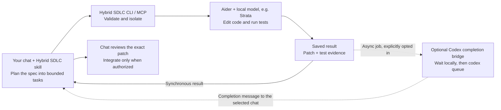

# Hybrid SDLC Toolkit

Hybrid SDLC (`hybrid-sdlc`) lets a cloud or host agent delegate a bounded coding
task to Aider and an OpenAI-compatible local model. The local worker edits and
tests in an isolated Git worktree; you review its patch before integrating it.

## How it works



For synchronous work, the waiting chat receives the result directly. For an
async job, the optional [Codex completion bridge](docs/codex-completion-bridge.md)
watches its saved status locally, then sends a completion message to an explicitly
selected existing chat using `codex queue`. The host can start a follow-up
response; the bridge does not need repeated model calls to check job status.
The bridge must be launched separately for that job with explicit continuation
authorization; submitting a job alone does not enable notifications.
The message carries compact job metadata, not source code or the patch; the chat
inspects the saved local artifacts before accepting the change.

Without that host-specific bridge, use bounded job-status waits. Standard MCP
alone does not guarantee chat wakeup. On restrictive Windows hosts where safe
async launch is refused, use synchronous execution instead. A completion message
is a cue to inspect the result, **not** approval to apply or merge the patch.
Queue acceptance and an actual chat response are distinct; the bridge reports
the former, not proof of the latter.

## What the toolkit provides

The host-native CLI and MCP server support synchronous tasks and persisted
asynchronous jobs, bounded retries/timeouts, cancellation, named test profiles,
and atomic run artifacts. A [lightweight planning workflow](docs/planning.md)
distinguishes fast modifications from dependent changes, with concise committed
task contracts and risk-based review. No Spec Kit installation is required.
Optional committed [task policies](docs/task-policy.md) check identity and limit
ceilings, then reject out-of-scope exported patches before scoped commits.
Explicit [review records](docs/review-acceptance.md) bind a decision to the exact
patch and baseline, with independently executed named-profile tests. Acceptance
does not apply the patch, create a commit, or merge it.

## Install and configure

Prerequisites: Python 3.11–3.13, [uv](https://docs.astral.sh/uv/), Git, Aider,
and a running local model endpoint. Docker/GPU support is needed only for the
optional containerized model deployment, not for the MCP server itself.

```sh
git clone https://github.com/rainier-brioso/hybrid_sdlc.git
cd hybrid_sdlc
uv tool install --python 3.12 .
uv tool install --python 3.12 'aider-chat==0.86.2'
hybrid-sdlc --help
```

Install your target repository's test runtime separately. From its root, create
`hybrid_sdlc.toml` with the endpoint/model you verified and a trusted test profile:

```toml
selected_model = "qwen3.8-flash-next-coder-iq1_m"

[[server_candidates]]
url = "http://127.0.0.1:8080/v1"

[command_profiles.tests]
argv = ["python", "-m", "unittest", "discover", "-s", "tests"]
cwd = "."
timeout_seconds = 180
```

Then check availability and run a committed specification:

```sh
hybrid-sdlc check --repo-root . --json
hybrid-sdlc run-task spec.md --repo-root . --task-id TASK-001 --test-profile tests --json
```

Use one committed contract per task; the task ID is a label, not a section parser.
Model availability is not inference readiness.
The result identifies the isolated checkout and review patch; passing tests
does not automatically apply it to the source checkout. Review the exact diff.
For the complete step-by-step workflow, including Windows/POSIX paths,
async polling, cleanup and uninstall, see [installation](docs/installation.md).
For failures, see [troubleshooting](docs/troubleshooting.md).
See [configuration](docs/configuration.md), the
[example profiles](hybrid_sdlc.example.toml), and [development](docs/development.md).

Endpoint URLs must be credential-free, without userinfo, query strings or
fragments. Task instructions are delivered through temporary private files,
not command-line text. Aider input/output is explicitly UTF-8. The optional
`aider_python` adapter supports Aider 0.86.2 only and keeps repository-map caches
outside the checkout; see the configuration guide before enabling it.

## Connect an agent host

The stdio server is launched with `hybrid-sdlc mcp` and exposes five tools:
`check_local_model`, `run_spec_task_sync`, `submit_spec_job`, `get_job_status`,
and `cancel_spec_job`. Track async jobs to a terminal state using bounded status
waits or the explicitly authorized Codex completion bridge shown above. MCP
registration alone does not provide cross-session wakeup or resume. Install the
host skill as well as the CLI/MCP to load the planning and delegation workflow.

Use the setup guide for [Codex](docs/hosts/codex.md),
[Antigravity](docs/hosts/antigravity.md), or [Claude Code](docs/hosts/claude-code.md).
Supporting a host does not require using it to develop this repository.
The [host compatibility matrix](docs/host-compatibility.md) separates observed
smokes from unverified host features.

## Local inference

The toolkit does not require a specific server launcher. Native and externally
managed OpenAI-compatible servers remain options. The current Strata evaluation
uses `qwen3.8-flash-next-coder-iq1_m`, pinned Strata 0.1.39, a 16K context,
int8 KV, low-RAM mode, and low-reasoning defaults.

From this repository root, the manual Docker setup is:

```sh
docker compose -f compose.strata.yaml build
docker compose -f compose.strata.yaml up -d
docker compose -f compose.strata.yaml logs -f strata-server
```

Read [Strata setup](docs/strata-server-docker.md) first: this candidate targets
an RTX 3090 with 24 GB VRAM and a 32 GB RAM host, requires NVIDIA GPU passthrough,
and downloads approximately 58.4 GB of weights. Allow at least 80 GB free disk.
Docker/WSL2 memory availability is distinct from installed host RAM.

Optional installed CLI [lifecycle management](docs/runtime-management.md)
provides explicit `configure`, `start`, `stop`, `restart`, `status`, `logs`, and
`diagnose` commands for a separately owned service. It does not adopt the manual
container or prepare its image automatically. Default diagnostics do not
generate; `--readiness` opts in to guarded inference. Recovery is explicit,
never an automatic response to one timeout.

The [llama.cpp deployment](docs/llama-server-docker.md) is retained; its remaining
live smoke rerun is paused during Strata evaluation. Docker/native parity and
representative coding benchmarks remain unverified.

## Recorded Strata measurements

These are small observations from October 4–12, 2026, not performance guarantees.
The observed setup was Docker/WSL2, RTX 3090 24 GB, roughly 32 GB host RAM,
and a roughly 24 GiB VM memory limit. Runtime/memory conditions varied.

| Observation | Recorded result | Scope |
| --- | --- | --- |
| New synthetic prompt on loaded model | 1,321 prompt tokens; first content 12.609 s; total 12.671 s | One sample, no prefix reuse, not a cold start |
| Two identical prompt repeats | 1,314 reused tokens; total 0.172 / 0.125 s | Cached samples, not fresh-prompt throughput |
| Installed MCP SDK smoke | 19.707 s; one attempt; two tests passed | Tiny two-file fixture, not a Codex-session proof |
| Antigravity synchronous smoke | 52.397 s; one attempt; two tests passed | User-reported host invocation, patch/tests independently reviewed |
| Controlled idle-cycle baseline | 74.13 s; one attempt; four tests passed | Isolated two-file task, map enabled |
| Same task after 25 h 30 m idle | 177.19 s; one attempt; four tests passed | Identical reviewed patch; no observed engine reload or manual restart |

Sources: [prompt protocol and measurements](benchmarks/results/strata/prompt-processing-20261004.md),
[installed MCP record](benchmarks/results/strata/installed-mcp-smoke-20261004.json),
and [Antigravity record](benchmarks/results/strata/antigravity-mcp-smoke-20261005.json).
The [controlled idle-cycle record](benchmarks/results/strata/long-idle-20261010.md)
includes fixed inputs, timestamps and limits. Its slower repeat spent about
158 seconds processing the prompt; the slowdown's cause is not established.
Earlier smoke requests decoded at 58.5–75.5 tokens/s, but prompt processing
dominated latency; this is not end-to-end coding throughput. Identical cached
requests must not be combined with fresh prompts to claim a typical speed.

One earlier Antigravity attempt timed out after 150 seconds. The successful
retry followed a user restart; neither the reported long idle period nor the
restart proves the timeout's cause. A later controlled long-idle cycle passed,
but one cycle does not establish sustained reliability. Native-versus-Docker
and representative coding benchmarks remain open in the
[implementation tasks](docs/implementation_tasks.md).
The [hardware benchmark protocol](benchmarks/README.md) defines the inputs and
measurements required before making runtime comparisons; its manifest template
is not a completed benchmark or a claim of native/Docker parity.

## Safety and project status

Use trusted repositories: configured test commands run with your user account's
permissions. Worktrees, path checks, redaction, and advisory locks are not an OS
sandbox. Keep secrets, model weights, and machine-local configuration out of Git.
Managed activity coordination cannot see unrelated API clients.

Packaging, managed lifecycle, guarded runtime diagnostics and the bounded
[security review](docs/security.md) are implemented; one controlled idle cycle
is recorded. Comparative benchmarks and clean-machine release rehearsals are
still pending: this is not yet a fully validated supported release.
The [clean-install rehearsal protocol](docs/release-rehearsal.md) and its
unexecuted evidence template describe the Windows/POSIX checks still required.
The checked [verification map](docs/verification-map.md) links public CLI/MCP
journeys to automated tests, installed-artifact checks and dated live evidence,
with remaining gaps kept explicit.
Windows background survival requires
a host allowing Job Object breakaway and is not proven on restrictive runners.
See the [plan](docs/implementation_plan.md) and [tasks](docs/implementation_tasks.md)
for completed work, validation limits, and remaining milestones.
